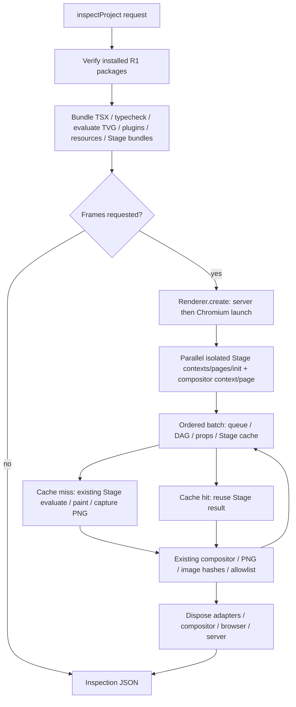

# DX-1C — explicit Renderer sessions

## Audit and scope

Baseline: `33b7b95`, branch `agents/agent-3`. The existing Renderer already owned one Chromium process, one WebAdapter per engine, one isolated context/page per Web Stage, one compositor context/page, a serialized frame queue and a bounded 128 MiB Stage LRU. An ACL-3 multi-frame inspection already created **one Renderer for the whole request**. Preview already owned its own long-lived Renderer and rebuild lifecycle. None of those systems needed replacement.

The repeated work was between independent `inspectProject` calls: compilation, resource preparation, server/browser startup, Stage initialization and disposal. `inspectIteration` is an on-disk bounded repair workflow; it did not retain Chromium. DX-1C adds optional host lifecycle injection to the same inspection service, plus a project-scoped owner in `modules/render-session`. Default one-shot behavior is preserved.

Original lifecycle:



With an explicit session, `prepare` reuses the validated compiled snapshot and `acquire` leases the owned Renderer. The batch loop, frame diagnostics, PNG writer, storyboard and image-access policy remain in ACL-3. Lease release leaves a healthy Renderer alive. Session close releases it. There is no global browser pool or daemon; separate sessions have separate browser processes and Stage realms.

## Shared TypeScript API

```ts
import {openRenderSession} from '../modules/render-session/index.ts';
import {readInspectionImage} from '../modules/render-inspection/index.ts';
import {dirname} from 'node:path';

const session = await openRenderSession(project, {
  mode: 'accurate', // existing SwiftShader policy
  cache: true,
  allowWasm: false,
  onProfile(event) { /* optional host wall-clock measurements */ },
});
try {
  const checked = await session.inspect(); // compile/verify; no Chromium
  const first = await session.renderFrames([12, 0, 6, 0], {storyboard: true});
  const second = await session.renderFrames([45, 46, 47]);
  const image = await readInspectionImage(dirname(second.reportFile), second.frames[0].image!.id);
  // image.content is an actual base64 PNG image block for a multimodal consumer.
  // image.bytes is verified against the report allowlist, bytes and RGBA hashes.
} finally {
  await session.close();
}
```

`openRenderSession` performs no compilation or browser launch. Each inspection writes to a new output directory (or a caller-specified empty directory). `inspect()` returns the existing `InspectionReport` v1. Requests may select frames/times, storyboard, Stage ID and output. Project, dimensions, capture policy, cache and WASM permission are immutable session options. Runtime checks reject unknown request fields; a request cannot widen permissions.

`AbortSignal` on a request cancels the **whole session**, including queued requests. `cancel()` and `close()` are terminal and idempotent; all callers await the same cleanup. Closing active Web pages interrupts a pending frame evaluation. Cancellation during compilation/Stage initialization waits for the existing bounded compiler/Stage operation to settle, then closes the partially created backend. It is not instant cancellation of TypeScript or arbitrary trusted Node code. `refresh()` serially retires the Renderer and build; the next request recompiles.

## Verification, isolation and invalidation

Every request goes through ACL-3 `installedPackages` verification before using compiled data. Session preparation additionally discovers the existing plugin catalog and hashes:

- Compiler-discovered source imports, the original entry and declared resource files; imported SVG/glTF linked files already appear in the compiler graph.
- Plugin catalog content identities, plugin config, the selected plugin lock (including custom lock paths), R1 config and exact package lock.
- Root/project package metadata and tsconfig.
- The sealed TVG, source graph, build description, served Stage bundles, split chunks and copied assets.

Hashes use actual file bytes, not timestamps. A change retires the previous Renderer and rebuilds through the ordinary compiler/type/lock/resource gates. Missing resources and changed pins fail explicitly; no previous successful frame is returned as the new result. Compiled snapshot objects are private to the session. Host `FRAMEWEAVE_HOME`/Chromium environment or package trust changes require a new reviewed session. No lock, source or trust permission is rewritten.

This is a request-boundary snapshot, not an OS-level atomic filesystem transaction. Do not edit input files while a batch is executing. Changes are checked at the next request. Arbitrary build-time Node filesystem reads and external Node dependencies that the existing compiler does not report require explicit `refresh()`; this service does not instrument arbitrary trusted author code. Engine source/runtime pin changes require a new Node process and final integration review.

An ordinary Stage exception produces a per-frame diagnostic and does not destroy unrelated successful frames. An unexpected browser disconnect is reported for affected frames without silently retrying them; the next request creates a new backend. A Stage timeout or failed Stage initialization retires the invalid backend. A session does not claim it can recover an arbitrary custom adapter whose disposal never resolves; its existing adapter contract is unchanged.

The lifecycle regression test first reproduced a bug in baseline `Renderer.close()`: a second concurrent caller returned before the first caller released Chromium. Renderer now shares its in-flight cleanup promise. This changes host cleanup completion only, not rendering, Stage DAG, TVG, P4 ABI, clock, CSP or WASM policy.

## Result and timing metadata

Existing EngineError/Diagnostic codes and source locations remain authoritative. Additional host errors are `E_RENDER_CANCELLED`, `E_RENDER_SESSION_CLOSED`, `E_RENDER_SESSION_POLICY`, `E_RENDER_SESSION_CHANGED` and `E_CHROMIUM_DISCONNECTED`. No parallel Agent result protocol is introduced.

Optional `report.session` contains `id`, `generation`, successful `builds`, successful `browserStarts`, `browserReused` for this request, and content `invalidations`. These are lifecycle counters, not runtime verification of an installed capability. Actual browser version is recorded for a healthy session; the physical GPU remains `not-probed`. Existing Stage-reported `backend` output is retained. `cache.stageHits` counts Stage-result reuse; final composition still runs, so `finalImageReused` stays false. The batch bound is narrowly raised from 48 to 50, retaining all pixel/byte/time limits.

`onProfile` uses host `node:perf_hooks` time. The Stage clock deliberately overrides browser `performance.now`; it must not measure lifecycle costs. Compiler checkpoints measure prepare, scene bundle, scene typecheck, TVG evaluation/validation, plugin preparation, Stage type/contracts, resource copies, Stage bundles and build sealing. Renderer spans measure Chromium launch, Web/compositor context and page creation, complete Stage initialization, Stage evaluate/asset settle/paint, PNG capture, compositor draw/encode, whole frame and cleanup. Callback exceptions cannot affect rendering.

Nested/parallel spans overlap and must not be added as if disjoint. `web.evaluate-and-paint` includes module work and paint fences; preview Canvas capture can also encode inside it. `web.png-capture` is screenshot/encode/transport wall time. `compositor.draw-and-encode` includes source PNG decode, draw, output encode and transport. GPU work, PNG codec work and driver synchronization are not isolated device timings; no GPU timer-query system is added. SwiftShader and preview-auto runs are reported separately. Auto/WebGPU availability alone does not establish a physical GPU.

## Agent-1 integration point

Public CLI/bin/package wiring is intentionally untouched. Agent-1 can export `openRenderSession`, `RenderSession`, `RenderSessionOptions`, `SessionInspection` and profiling types from the Node surface, then let an explicit in-process workflow own a session in `try/finally`. Keep one-shot `frame`, `storyboard`, `render`, direct TSX preview and `inspect` lifetimes unchanged. Do not add cross-process pooling or background startup. Existing Tool Result v1 wrapping, error exit codes and image handlers should be reused. A future MCP transport can retain a bounded session under its own authorization/lifetime policy and call this same service.

The optional `InspectionExecution` argument is host-only dependency/lifecycle injection, not an Agent-controlled JSON field. It must not accept third-party callbacks from a registry. Its default uses the existing build and Renderer paths.

No locks were refreshed in this branch. Changes under `src/` necessarily change SDK Runtime Pin. The final combined SDK pin and example locks must be reviewed by the integration owner, as required by the DX-1 common constraints.

## Reproduction

From this worktree, with its own dependencies and outputs:

```powershell
$env:FRAMEWEAVE_HOME = '\\?\' + (Join-Path (Get-Location) '.frameweave/user-home')
npm run typecheck
node --import tsx --test tests/render-session.test.ts
node --import tsx scripts/verify-render-session.ts
```

The verification script measures the pre-existing one-shot route and explicit session route in the same process, tests 1/5/20/50-frame batches with cache on and off, checks random/repeated frames against decoded pixel hashes, invokes independent real CLI processes, creates storyboards, writes/decodes MP4, and executes the existing GPU example under software and auto policies. It writes raw timing events and actual inspection artifacts under `artifacts/dx-1c`. It does not flush OS caches or establish a statistical performance guarantee. See `DX_1C_VALIDATION.md` for this run's raw logs, results and uncovered scope.
