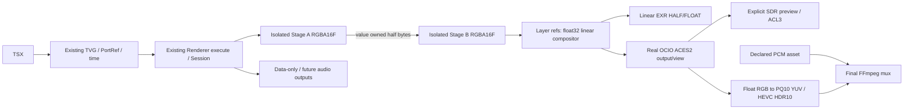

# Professional Media Engine — implementation and acceptance

Baseline: `74a8031`, branch `agents/agent-1`. Tested on Windows x64, Node 22.19.0,
Python 3.13.7, Chromium 156.0.8078.4 / Playwright 1.64.1. This is an offline high-precision
image/HDR foundation, not a claim of feature, realtime-performance, reference-monitor
or vendor certification equivalence with Adobe, Resolve or Apple applications.

## What ships

Real RGBA16F travels through the existing isolated Web Stage A → PortRef → Stage B
path. Float32 composition retains negative and above-one RGB. An explicit OCIO
ACES 2.0 display/output transform drives SDR inspection and real HDR10 output.
OpenEXR HALF/FLOAT, TIFF16, HLG, ProRes and DNxHR adapters have external decode
tests. Ordinary PNG/Canvas/MP4 defaults remain unchanged. No new DAG, animation
evaluator, plugin ABI, package manager, GPU Host or analysis scheduler was added.

The implemented transport is CPU value-owned base64. It deliberately has a material
copy/validation cost. Existing Stage-local GPU texture reuse remains available through
`modules/gpu-effects`; cross-Stage GPU handles and float HDR shaders are **not**
advertised as implemented. See the measured costs and remaining capability matrix.

Stage output is not synonymous with an image: `Renderer.evaluateFrame()` returns
declared ports without composing or inventing a Surface. Only Layer source/mask
references enter image composition. See [audio interval proposal](PME_AUDIO_STAGE_CONTRACT.md)
for future optional audio ports on the same DAG. Only asset-based PCM mux is implemented.

## PME-0: audited baseline and reuse

| Area | Actual baseline / source | Reused or minimal extension |
|---|---|---|
| Surface | `src/core/types.ts::Surface`, `ports.ts`, `graph.ts` accepted PNG data URLs | Legacy interface retained; versioned `ProfessionalSurface` added to PortValue and surface validation |
| Web execution | `src/render/web-adapter.ts::WebAdapter` captures surface output as PNG; `src/web/bootstrap.ts` already returns explicit outputs over MessagePort | Explicit Surface v2 bypasses screenshot; opaque iframe, CSP, timeout and disposal stay in place |
| Scheduling/time | `src/render/renderer.ts::Renderer`, graph levels, Stage-local context, fixed-step replay, bounded StageCache | One common `execute()` path for PNG, professional frames and data-only evaluation; same queue/cache/dependency execution |
| Composition | `src/render/compositor.ts::Compositor` uses Canvas2D and PNG | Preserved default; `src/media/compositor.ts` opt-in float linear CPU adapter |
| GPU | `modules/gpu-effects/core.ts::ChainCore`, `shaders.ts`, texture pool, queue/fence and dispose | Existing RGBA8 passes reused; optional timestamp queries and explicit larger pixel budget only; no parallel shader framework |
| Encoding | `src/encoding/ffmpeg.ts::VideoEncoder` pipes PNG to H.264/yuv420p with `-an` | Preserved; final-output `ProfessionalVideoEncoder` pipes float/16-bit bytes to same FFmpeg provider |
| Media resources | Compiler Resource/BuiltProject assets + server whitelist; P4/R1 verified bytes | No permission/resource bypass; image adapters are explicit host APIs, not new Stage filesystem access |
| Session / ACL-3 | `modules/render-session/index.ts`, `modules/render-inspection/inspect.ts` | Same Session lifetime, options sealing, real PNG inspection; optional media policy included in comparison identity |
| Port polymorphism | `PortType` already includes number/string/boolean/json; Stage inputTypes/PortRef | Data-only end-to-end test; no blanket image conversion of Stage results |
| Audio | Existing VideoEncoder explicitly `-an`; no audio port/range executor | Strict PCM asset mux prototype, exact samples/frame duration; future interface proposal only |

`src/compiler/typecheck-worker.mjs`, core authoring/graph/port validation receive only
the additive descriptor/Layer fields. TVG remains schema `0.1`; Stage time semantics
and topology are unchanged. New Surface packets have their own explicit schema.
`defineMediaStage` refuses an old host without Surface v2 CPU transport instead of
allowing that host to silently screenshot a new module. Explicit mask/isolation
requests on the old Canvas compositor fail rather than pretending to implement them.

## Surface, colour and ownership contracts

Public browser-safe exports from `@frameweave/engine` and `/web`:
`ProfessionalSurface`, `ColorEncoding`, `surfaceFromPixels`, `pixelsFromSurface`,
`assertProfessionalSurface`, `defineMediaStage`, `assertProfessionalRuntime`,
`transformSurface`, `gamutMatrix`, PQ and `.cube` helpers. Host adapters are in `/node`.

```ts
interface ProfessionalSurface {
  kind: 'surface'; schemaVersion: 'frameweave.surface/2';
  format: 'rgba8unorm' | 'rgb10a2unorm' | 'rgba16float' | 'rgba32float';
  width: number; height: number; rowStride: number;
  bitDepth: 8 | 10 | 16 | 32; numericRange: 'unorm' | 'extended';
  color: ColorEncoding; alpha: 'straight' | 'premultiplied' | 'opaque';
  storage: {
    location: 'cpu-inline'; encoding: 'base64'; byteOrder: 'little-endian';
    ownership: 'value'; lifetime: 'frame'; data: string;
  };
}
```

Interleaved RGBA, whole padded rows, deterministic IEEE binary16 ties-to-even.
RGB10A2 is packed little-endian R bits 0–9, G 10–19, B 20–29, A 30–31; its alpha
is two bits, not ten. Floating RGB is finite extended range; alpha stays [0,1].
Opaque requires alpha one. Stride/byte length/format/metadata are checked; limits are
16384 per dimension and 512 MiB decoded allocation. No remote URI or device pointer
is accepted as inline storage. Value ownership means no external free callback or
shared mutable allocation; cache eviction/GC and Session close release host values.

Future GPU/file/multiplane descriptors need versioned ownership, device identity,
producer-completion and release contracts. They currently fail `E_MEDIA_TRANSPORT`.
10/12/16-bit planar YUV is ingested by a separate tagged FFmpeg/zimg adapter into
RGB32F, not misrepresented as packed RGBA. Current YUV reader accepts limited-range
tagged planar YUV; unknown/full-range/RGB layouts fail explicitly.

Future non-RGB wire extension must describe plane offsets/strides/sample packing,
subsampling, chroma siting, legal/full range and matrix separately from primaries/
transfer, with exact byte lengths and owned lifetime. It must negotiate a recognized
format/version before execution. Current12-bit input goes through that explicit host
conversion boundary; native12-bit YUV output packets/12-bit HEVC are not implemented.
The tested subsampling/chroma reconstruction follows the actual codec/zimg path;
untagged alternate chroma-siting conventions need further reference validation.

Colour description independently names primaries, white point, transfer, scene/display
reference, full RGB code range and reference-white luminance. Rec.2020 is not PQ.
ACEScg is AP1/D60; Rec.709/2020 and Display P3 are D65. The analytic adapter uses
RGB/XYZ matrices and Bradford white adaptation; it is a colourimetric transform,
**not** the ACES rendering transform. PQ uses absolute SMPTE ST2084 luminance up
to 10000 cd/m²; `referenceWhiteNits` scales scene-linear relative samples. HLG uses
Rec.2020 OETF plus an explicitly supplied display peak and system gamma OOTF.
It is not a full ambient-adaptive broadcast display simulation.

Pipeline choices are explicit and separate:

1. Input interpretation: `readIccImage`, `readMediaVideo`, `readExr` or an authored descriptor.
2. Working/effect space: authored Stage input/output colour metadata.
3. Composition: `MediaPolicy.workingColor`, scene-linear, premultiplied float32.
4. Preview: explicit `MediaPolicy.preview`; optional OCIO display/view then bounded sRGB PNG.
5. Intermediate: linear EXR without preview baking.
6. Delivery: explicit colourimetric or OCIO transform, clipping decision and alpha policy.

Straight pixels are unpremultiplied before nonlinear transforms, then re-premultiplied.
Zero-alpha hidden premultiplied RGB has no recoverable colour and resolves to zero.
Negative/above-one scene values survive internal composition. PQ invalid luminance,
LUT out-of-domain, missing metadata and conflicting tags have `E_MEDIA_*` errors.
Preview/output clipping requires `clip:true` and records counts; the actual ACES
view produces a small float overshoot (~1.0000067), so the example explicitly permits
preview clamp. This does not alter scene intermediates or silently authorize HDR clipping.

Real OCIO uses `src/media/ocio_bridge.py`, OCIO 2.5.2 and built-in
`cg-config-v4.0.0_aces-v2.0_ocio-v2.5`. Serialized config SHA-256 on this environment:
`24ec81841048fc5db160a7bad882263246183385c5d49d0e86e11464917ead15`.
`ocioInfo()` lists actual spaces/displays/views. Processor ID/config hash/runtime
version are recorded in `.media.json`; changes within one video are rejected.
Only pinned built-in cg/studio ACES2 configs are accepted. Arbitrary file configs,
remote LUT/config resolution and automatic downloads are unsupported.

ICC uses existing libvips/LCMS through optional PyVips 3.2.0: explicit relative
colourimetric `icc_import` into float Lab PCS, then `icc_export` at16-bit. Alpha
bypasses the colour processor. Sharp reads metadata only. The first packed-transform
implementation failed the colour-cube criterion (CIE76 max2.94); the actual float-PCS
path reduces that to .37441 for P3 and .012275 for sRGB. This is an SDR ICC adapter,
not float HDR ICC. Missing
ICC requires explicit `assume-srgb`; malformed ICC or decode warnings fail. LUT
support is single `.cube` 1D or 3D trilinear, not combined/shaper or tetrahedral LUT.

## Composition and Stage integration



`compositeMedia` supports Source-over, Add (`lighter`), Multiply and Screen in
linear premultiplied float. Affine transforms use bilinear sampling of premultiplied
RGBA, transparent outside the image. Mask alpha is sampled in layer-local coordinates.
Groups are isolated by default in this opt-in professional path; pass-through must
be requested. Group opacity is applied once after child composition, not inherited
per object. Unit reference: isolated red/blue group gives `[0,0,1,.5]`; applying .5 to
each object gives `[1,0,1,.75]`. Masked pass-through groups and Canvas-only filters
fail with specific diagnostics. Background accepts transparent or explicit sRGB
`#RRGGBB[AA]`. Advanced sampling, motion blur and additional blend modes are not claimed.

Mixing old PNG sources requires `legacySdr:'srgb'` and emits
`I_MEDIA_SDR_EXPANSION`: conversion cannot recover the original eight-bit precision.
Legacy P4 image-input contracts reject professional surfaces with
`E_MEDIA_PLUGIN_FORMAT`; this does not secretly upgrade old plugins or change their ABI.
Float-aware native Web Stages use the public Surface contract directly. No GPU texture
management is required in TSX.

Example editable sources: `examples/professional-media/project.tsx`, `stages.ts`,
`settings.json`. A produces half ACEScg negative/highlight/alpha values; B explicitly
receives a Surface and applies exposure using the existing frame context. Layer
composition and final policy stay outside the Stage algorithm.

```ts
import {openRenderSession, acescg, srgb, writeExr} from '@frameweave/engine/node';
const session = await openRenderSession('project.tsx', {media: {
  workingColor: acescg,
  preview: {color: srgb, clip: true, ocio: {
    source: 'ACEScg', display: 'sRGB - Display',
    view: 'ACES 2.0 - SDR 100 nits (Rec.709)'
  }}
}});
try {
  await writeExr((await session.mediaFrame(5)).surface, 'frame-0005.exr');
  await session.inspect({frames:[0,3,5,3], storyboard:true, output:'inspection'});
} finally { await session.close(); }
```

EXR sequences use `session.mediaFrame(frame)` + `writeExr` per frame, with an explicit
chosen filename. The CLI `media frame` writes one EXR; no automatic image-sequence
naming convention or resumed sequence writer is claimed. TIFF16 writes a single
image; colour policy also survives in the sidecar. Use `writeIccTiff` when an embedded
SDR ICC profile is required.

## Delivery capability matrix

| Path | Implementation and actual verification | Restrictions |
|---|---|---|
| PNG / old H.264 | Existing renderer/encoder, regressions | Eight-bit SDR remains intentional |
| Surface RGBA16F/32F | Real Web A→B and NumPy half oracle; float composition | CPU/base64 only across Stage realms |
| HDR10 | libx265 Main10/yuv420p10, Rec2020/PQ/2020nc, mastering + CLL/FALL, actual float decode | Software encoder, 4:2:0; author supplies metadata, no automatic MaxCLL/FALL analysis or monitor certification |
| HEVC10 / SDR H.264 professional adapter | Presets query actual encoder/filter availability | No HDR inferred just from 10-bit; full delivery quality test focuses HDR10/HLG |
| HLG | Actual 10-bit HEVC encode/decode and numeric code comparison | Explicit peak/system gamma; no PQ mastering metadata |
| EXR | OpenEXR 3.4.4 scanline ZIP, real HALF/FLOAT channels/chromaticities/alpha | Linear RGBA only; tiled/deep/multipart EXR unsupported |
| TIFF16 | Direct CPU full-range RGBA16 packing → TIFF; real 16-bit decode | Generic float→swscale path intentionally bypassed; sidecar colour or separate embedded ICC writer |
| ProRes 422 / HQ | prores_ks, actual profiles/yuv422p10, float decode | Lossy/subsampled, flatten matte required; sharp colour-edge error retained in report |
| ProRes 4444 / XQ | prores_ks, actual 4444/XQ/yuva444p12 decode with alpha | **Effective colour input is 10-bit** on tested FFmpeg. A 12-bit decoded stream does not imply 12-bit effective source precision |
| DNxHR HQX | dnxhd/ DNXHR HQX, actual yuv422p10 decode | Size constraints from encoder, no alpha; not all DNxHR profiles implemented |
| YUV12 input | FFV1 yuv444p12 lossless test → float32, 1024 levels | Explicit tags/reference white; not a 12-bit HEVC output claim |
| ICC / ACES2 | Real LCMS16 and actual OCIO config/view | ICC float-HDR and arbitrary custom OCIO configs unimplemented |
| GPU HDR/cross-Stage texture | Capability query explicitly false | Current existing GPU chain is RGBA8; not used for professional float composition |
| Audio asset mux | Actual 48k/24-bit PCM MOV + decoded byte equality | No audio Stage/range executor or DSP; 96k/multichannel contract not yet acoustically validated |

`mediaEncodingCapabilities()` and `frameweave media capabilities --json` distinguish
encoder presence (`available`) from per-platform media validation (`runtimeVerified:false`).
Successful format tests in this report do not globally rewrite that static capability.
Actual codecs/filters differ by FFmpeg build. No Apple/Avid certification or encoder
licensing rights are implied by codec availability.

ProRes alpha deserves a separate path: zscale's limited-range conversion also
scaled alpha in an initial experiment. The adapter now converts RGB to YUV separately
and appends full-range alpha. Decoder validation similarly obtains RGB float and
integer16 alpha separately. TIFF initially suffered swscale intermediate precision
loss; it now packs full-range uint16 directly. Both fixes preserve the numeric tests.

## Security, release and failure boundaries

WASM authorization remains default false; no CSP tokens, sandbox flags, network
whitelist or Worker permissions changed. Professional Surface is a declared output
value, not an arbitrary file/device capability. The Python bridge is a fixed host
adapter with explicit executable selection, bounded subprocess lifetime, owned
temporary files and cleanup; Stage code cannot choose its Python path or operation.
No `eval`, server deployment or automatic native tool install is introduced.

`FRAMEWEAVE_MEDIA_PYTHON` and external `FRAMEWEAVE_FFPROBE` are explicit host settings.
The optional provisioning recipe is in `tools/professional-media/README.md` and never
runs during rendering. Session seals these paths along with the existing policy so
environment changes require reopening. Native OCIO jobs currently spawn a process
per operation; they are bounded but are not instantaneously interrupted by AbortSignal.
Encoder cancellation kills its owned process. A failed/cancelled output can remain
partial and has no success sidecar; it must not be treated as a completed delivery.

Encoder writes are sequential with stdin backpressure, bounded stderr and explicit
finish/abort. Existing output paths are refused by the video writer. Durations,
output transform, executable arguments, clipping counts and bounded per-frame records
are saved to `.media.json`. No output is marked successful before encoder exit zero.
Sample origin/duration mismatches fail rather than silently trimming/padding audio.

SDK source changes necessarily change Runtime Pin. No existing example/plugin lock
was silently refreshed. Tests that need new locks explicitly create private fixtures.
P4/R1 integrity, trust, resource whitelist, WASM kit and opaque iframe regressions
remain required. New additive APIs require a matching SDK; old hosts cannot reliably
load new Surface imports and are explicitly guarded by `defineMediaStage`.

## Reproduce

Provision only reviewed dependencies, set private `FRAMEWEAVE_HOME`, explicitly install
the Playwright browser using the existing CLI, then set `PLAYWRIGHT_BROWSERS_PATH`.
See [optional native setup](../tools/professional-media/README.md).

```powershell
npm run typecheck
node --import tsx --test --test-concurrency=2 tests/professional-media.test.ts
node --import tsx scripts/verify-professional-media.ts
node --import tsx scripts/benchmark-professional-media.ts
node --import tsx --test --test-concurrency=2 tests/*.test.ts
npm run frameweave -- media capabilities --json
npm run frameweave -- media frame examples/professional-media/project.tsx --settings examples/professional-media/settings.json --frame 5 --output artifacts/scene-0005.exr --json
npm run frameweave -- media render examples/professional-media/project.tsx --settings examples/professional-media/settings.json --output artifacts/scene-hdr10.mp4 --json
```

Both services and CLI use existing Agent Tool Result v1. Image/frame APIs accept no
hidden WASM permission: pass `--allow-wasm` only after explicit authorization. The
professional media commands are independent additive wiring in `src/cli-entry.ts`;
ordinary `frame/render/storyboard`, ACL1/2/3 and REPL retain existing paths.

## Standards, dependency and source provenance

Actual native libraries are reused, not recreated: OCIO 2.5.2, OpenEXR 3.4.4,
NumPy 2.3.4, PyVips3.2.0/CFFI2.0.0 (upstream notices retained under `licenses/professional-media`),
existing sharp/libvips/LCMS, zimg and FFmpeg. Python wheels are separately provisioned,
not bundled into npm. Version pins are reproducible API versions, not cross-platform
wheel byte locks. Existing ffmpeg-static 5.3.0 supplies a tested FFmpeg 6.1.1 essentials
GPLv3 build; the installed external ffprobe is 9.0.2. The encoding/decoding tests use
the default 6.1.1 binary, not an undisclosed system replacement. Redistribution needs
the appropriate upstream source/notice and codec licensing review.

Primary references: [OCIO ACES configs](https://opencolorio.readthedocs.io/en/v2.5.2/configurations/aces_cg.html),
[OCIO 2.5 release](https://opencolorio.readthedocs.io/en/latest/releases/ocio_2_5.html),
[official ACES config releases](https://github.com/AcademySoftwareFoundation/OpenColorIO-Config-ACES/releases),
[FFmpeg codec documentation](https://www.ffmpeg.org/ffmpeg-codecs.html).
The ICC binding uses [libvips' official import/export operations](https://libvips.github.io/pyvips/vimage.html),
the same installed libvips8.18.7 as sharp on Windows. PyVips' reviewed source archive
is SHA-pinned; ABI mode introduces no additional libvips binary download. Its Python
build requirements are pinned and installed explicitly, not during rendering.
Code evidence is the actual installed library, serialized config hash and ffmpeg help
recorded by verification, rather than a README-based claim about native capabilities.

See `PROFESSIONAL_MEDIA_VALIDATION.md` for raw-run locations, measured errors,
timing tables, regression counts and remaining limitations. Those results, not the
presence of an API name, determine milestone acceptance.
