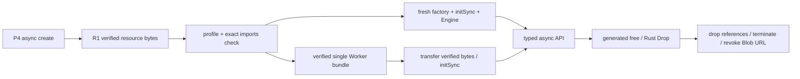

# Rust/WASM Module Kit v2 — wasm-bindgen data profile

Kit v2 增加一条可复制的 `wasm-bindgen-data-v1` 路径。`bytes-v1` 仍为默认模板；两个 profile 并存，不改变既有 ABI、TVG、P4 API、R1 包格式或 CSP。适用范围是同步数据计算和经过审阅的数据回调，不是任意 Rust/JavaScript 宿主兼容层。

## 三层契约

| 层 | 本 profile 的责任 | 版本与兼容方式 |
|---|---|---|
| Rust 内部 ABI | Rust 类型、分配器、所有权与 Drop | 由 Rust/wasm-bindgen 管理；不实现 `fw_alloc/fw_call` |
| JS/WASM binding | 生成的 imports、UTF-8、typed arrays、Engine/free、异常 | `wasm-bindgen=0.2.129` 精确匹配 CLI；`wasm-bindgen-data-v1` revision 1；新增 intrinsic 必须审阅 |
| Frameweave P4/R1 | Schema v2 参数、异步 create/render/dispose、资源及内容锁 | Manifest/API 1 与 R1 schema 1 不变；主机仍须 `allowWasm:true` |

`src/packages/runtime.ts::packageModuleLoader` 对 `core-v1` 的空 imports 限制保持原样。新 profile 将 WASM 声明为现有 `resource`，由 Kit 内 `runtime/client.ts` 获取 R1 verified bytes，再交给经过审阅的 JS binding。包仍声明 `wasm` 能力；声明本身不会授权执行。

## 从零创建

要求 Node >=22、项目锁定的 npm 依赖、Rust 1.99.1、`wasm32-unknown-unknown` 标准库、可用的 Cargo 宿主链接器和 wasm-bindgen CLI 0.2.129。不要在运行期安装工具或下载依赖。

```powershell
# SDK 根目录。新目录必须不存在。
node tools/rust-wasm-kit/kit.mjs init work/my-bindgen-module --id studio.my-bindgen --authority studio.reviewed --template wasm-bindgen --example lyon --execution direct
# 第二种独立 recipe：--example bindings --execution worker
# 不指定 --template 仍生成 Kit v1 的 statistics/bytes-v1。

# 仅 Windows x64：显式获取官方固定版本 CLI，下载与执行文件均校验 SHA-256。
node tools/rust-wasm-kit/provision-bindgen.mjs
cd work/my-bindgen-module
node module.mjs fetch                 # 显式 Cargo fetch --locked，可联网
node module.mjs build                 # Cargo build --locked --offline
node module.mjs types --check
node module.mjs test
node module.mjs test --browser        # R1 安装、CSP、随机帧和真实 MP4
node module.mjs pack --output .frameweave/reviewed-package
```

在 SDK 目录外构建时设置 `FRAMEWEAVE_ENGINE_ROOT`。可用 `RUSTC`、`CARGO`、`WASM_BINDGEN` 选择已审阅工具；CLI 与 crate 版本不符会拒绝。`CARGO_HOME`、`FRAMEWEAVE_CARGO_TARGET_DIR` 默认是模块私有缓存。Windows 深路径可使用**同工作区**短路径；不要共享其他工作区缓存。GNU 主机可设置 `CARGO_TARGET_X86_64_PC_WINDOWS_GNU_LINKER` 指向已安装的可用链接器。可选 `FRAMEWEAVE_RUST_SYSROOT` / `FRAMEWEAVE_RUST_LINKER` 仅选择已审阅的 wasm 目标工具，不下载工具。

修改依赖后，用独立的 `node module.mjs lock` 更新 Cargo.lock 并审阅差异；普通 build/fetch 不会悄悄改锁。只支持精确锁定的 crates.io 依赖。构建在调用 Cargo 前后核对 crate 归档 SHA-256 与 Cargo.lock，并将展开目录的每个源码文件与归档比较，拒绝额外文件、链接和改动；Cargo 自身的可变缓存校验文件不是唯一依据。

## 替换算法，保留基础设施

编辑 `rust/Cargo.toml` 和 `rust/src/lib.rs`，使用正常 `#[wasm_bindgen]` API。当前 profile 约定：

- 导出 `Engine`，无参数构造函数；显式 `free()` 由生成器提供。
- 方法同步接收/返回 `number/string/boolean/void`、受支持的 typed arrays（Uint8/Uint32/Int32/Float32/Float64），可选 undefined；不接收任意对象、函数、DOM 或 Promise。
- Rust `Result<_,JsValue>` 转为 JS 异常；适配器传播为 `E_BINDGEN_CALL`，保留原信息。
- 导出 `live_sessions()`，在构造/Drop 中计数，以验证显式释放。它是本 profile 的检查约定，不是新的 P4 ABI。
- 外部 crate 的指针/类对象应在 Rust wrapper 内封装；输出普通数据。不要让 Agent 管理裸 Memory。

`build/audit.mjs::publicApi` 从生成的 `module.d.ts` 提取方法签名和 Rust JSDoc。`generated/api.ts` 使用 `Pick<Engine,...>` 与映射类型生成异步公共 API，隐藏 free/Memory/imports；`generated/p4.ts` 从已有 `effect.json` Schema v2 生成 `use` 与 `Parameters`。`generated/agent-api.json` 包含名称、签名、限制说明、参数默认值、错误和执行环境，是包内元数据，不是新注册中心。

```ts
// 插件内部：现有 init.loadModule；同一个 API 可选择 Worker。
const api = await createEngineApi(init.loadModule, {worker: true});
const text = await api.normalize('  Frameweave 中  ', new Float64Array([1,2,3]));
// "FRAMEWEAVE 中:6.00"
const scaled = await api.scale(new Float64Array([1.5,-2]), 2);
await api.dispose();
```

```tsx
import {Composition} from '@frameweave/engine';
import {PluginStage,plugin} from '@frameweave/engine/plugins';
export default <Composition width={128} height={96} fps={12} durationInFrames={12}>
  <PluginStage id="geometry" pipeline={[
    plugin('studio.my-bindgen@1.0.0', {shape:{scale:0.8}})
  ]}/>
</Composition>;
```

运行前用现有 `packages install` 明确信任本地 authority，运行 `effects lock`；支持原有 `packages verify/restore`。实际 CLI 参数以 `npm run frameweave -- help` 为准。示例命令：

```powershell
npm run frameweave -- packages install work/my-bindgen-module/.frameweave/reviewed-package --project work/my-project/project.tsx --trust local:studio.reviewed
npm run frameweave -- effects lock --project work/my-project/project.tsx
npm run frameweave -- frame work/my-project/project.tsx --frame 6 --allow-wasm --output artifacts/bindgen.png
npm run frameweave -- export work/my-project/project.tsx --single-file --layout capsule --output artifacts/Portable.tsx
```

## JS imports 的来源和约束

`wasm-bindgen --target web --typescript --omit-default-module-path` 产生 ESM glue、`.wasm`、`.d.ts`、WASM 导出类型和必要 snippets。WASM 的 `./module_bg.js` import namespace 由生成的 `__wbg_get_imports` 对象提供，含异常/externref 表辅助函数；它不是需要下载的 JS 文件。`./snippets/<crate-hash>/js/host.js` 则是实际静态 ESM import，先收集并审查，再打入 factory/Worker。

`import-policy.json` 固定 generator 与 intrinsic **规范化函数体 SHA-256**。`module.config.json.snippets` 固定 authored JS 哈希。构建检查 JS 与 WASM 两套 import 列表，不接受未声明文件、外部 URL、导入的 memory/table/global 或未经审阅的 intrinsic。`node module.mjs audit` 仅展示候选函数体/哈希，**不会批准或自动学习新权限**。

Snippet 限制为少量数据计算：数字、字符串、私有计数和明确允许的方法。AST 名称解析拒绝 fetch、globalThis、DOM、eval、Function、动态 import、计算属性、constructor、Math.random 等。完整 factory 在 tree shaking 后再次检查 ambient globals。这是 trusted-code 构建门禁，不是任意恶意 JS 的完备静态证明。引入新能力需要独立设计与批准，不应删掉检查来通过某个 crate。

原始 glue 的 async 默认初始化包含 fetch/URL 路径，但**作为审计资源携带，不执行**。esbuild 仅保留 `Engine/initSync/live_sessions`，在每次 `createBinding()` 内构造独立闭包；最终 factory 没有动态 import、eval、Function 或 fetch。`initSync({module:compiled})` 只接收已经验证的字节编译结果。不从 `import.meta.url` 猜测路径，也不隐式下载代码。

## 生命周期与 Worker



直连由 Stage 执行；Worker 是同一个 runtime 打出的单一 IIFE bundle，包含 glue/snippets，不使用 importScripts/fetch。Stage 从 verified Worker bytes 创建 Blob URL，完成初始化后传递复制的 WASM buffer。RPC v1 是 Kit 的私有 Worker 消息协议，和 P4/R1 版本独立。

`runtime/wire.ts::cloneData` 限制输入尺寸/深度并复制 typed arrays，不让调用者输入被 transfer 后失效。wasm-bindgen 在 JS/WASM 之间复制数组/编码 UTF-8；生成的向量返回值复制到 JS 后释放 Rust 分配。Worker 的输出 wire 还会复制一次 typed array，再 transfer 交还。直连客户端目前也执行一次输入验证复制；本 profile 的 wrapper 应显式返回结果，Worker 不回写输入数组的原位修改。没有宣称零拷贝。

Worker 初始化有独立 deadline；直连初始化受现有 WebAdapter 初始化 deadline 约束。renderAt 不创建计时器，沿用 WebAdapter 现有帧超时。Worker crash、协议错误和 abort 拒绝 pending 请求、terminate 并 revoke Blob URL。协作 dispose 调用生成的 free、确认 live_sessions=0，然后清理；重复 dispose 安全。Worker 中止或 Stage 硬超时无法保证 Rust Drop 已协作运行；realm 销毁是最终边界。直连同步 WASM 不能在同线程抢占，长计算应放 Worker。free 不代表 WASM 线性内存页立即归还 OS。

每个 Stage 独立 realm，且每个 client 新建 factory/Engine；R1 缓存 verified bytes 不等于共享 WASM 实例。没有全局 WASM Host。

## 完整性与可携带输出

`dist/build.json` 记录 authored sources、全部生成资源 SHA-256、Rust/Cargo/CLI/esbuild 版本、CLI 文件哈希和 Cargo 源码清单。变动的构建时间单独放 `.frameweave/last-build-metrics.json`。pack 在新目录收集普通文件，通过现有 R1 canonical integrity 形成包，拒绝源外依赖、链接、缺失/变动的生成产物和 stale 类型。

WASM、factory 原文、Worker、profile、原始 glue、snippets、`.d.ts` 都作为 R1 resources 验证；依赖许可证、Cargo.lock、来源和工具信息也在包完整性中。R1 安装、精确版本锁、恢复和导出没有改动。

目录与 Capsule 导出携带完整资源和锁；必须用源包及原安装目录物理不可用的方式测试。仍依赖兼容 SDK/Node/browser，不等于只有 TSX 就能离线运行。flat TSX 对 managed loader 明确报 `E_FLAT_EXPORT`，不静默丢 WASM。

## 示例、来源与边界

| 示例 | 实际算法/绑定 | Cargo 许可证 | 调用形式 |
|---|---|---|---|
| `examples/rust-bindgen/lyon` | `lyon_tessellation=1.0.23`，`FillTessellator::tessellate_path`；真实数字 JS callback | MIT OR Apache-2.0；依赖清单见 licenses/dependencies.json | 直连 Stage；XY 输入 → 三角形输出 → Canvas |
| `examples/rust-bindgen/bindings` | 字符串经过真实 JS normalize callback；数组缩放；Result 错误 | wasm-bindgen MIT OR Apache-2.0 与各依赖许可证 | Worker；UTF-8/f64 数组输入输出 |

Lyon 源码审阅包括 `Cargo.toml` 和 `src/fill.rs::FillTessellator::tessellate_path`，不是依据 README 推断可移植。已选择同期活跃版本，发布源/校验和来自 [crates.io](https://crates.io/crates/lyon_tessellation/1.0.23)，[上游源码](https://github.com/nical/lyon)。生成器来源是 [wasm-bindgen 0.2.129 官方发布](https://github.com/wasm-bindgen/wasm-bindgen/releases/tag/0.2.129)，实现参考 `crates/cli-support/src/js/mod.rs` 的 web loading/import generation。

每次 build 从真实 Cargo metadata 和已锁归档收集 notices。Lyon 发布包遗漏的根许可证按 `.cargo_vcs_info.json` 指定提交从官方仓库补齐，override 的 URL、revision、SHA 均携带并验证。不要将这些 override 用于不同版本。Kit 自身 Apache-2.0；生成文件保留上游 MIT/Apache 标记；Rust std 通知沿用 v1 已审阅版本。完整列表随包。

本轮验证平台为 Windows x64、Node 22、Playwright Chromium。Firefox/Safari/mobile、其他主机工具链尚未验证。不同操作系统、工具链、链接器、Cargo build script、绝对路径、esbuild 版本可能改变字节；同机锁定构建重复哈希一致不等于跨平台可复现。当前 Lyon 二进制中保留 Cargo 缓存的 panic 源码路径字符串，移动 Cargo home 可能改变产物哈希；运行期没有读取这些路径的 imports，源目录不可用的运行/导出测试另行验证。需要跨机器相同字节时，应单独完善依赖路径映射及工具链镜像约束。

体积、gzip 与调用成本可在 SDK 根目录重复测量：`node tools/rust-wasm-kit/measure.mjs`。脚本记录 Node 首次/重复实例化和含编码/分配的实际数据调用，输出 `artifacts/wasm-bindgen-v2/performance.json`；不同模块算法不同，不能据此声称某个 ABI 更快。浏览器的 Stage 时钟是确定性的虚拟时钟，直连初始化不能用它伪造耗时；Worker 原生时钟及主机墙钟需分开记录。

不支持 WASI、Emscripten、SharedArrayBuffer、多线程、任意 Web API imports、异步网络库、GPUTexture 传递。相关 crate 应拒绝并提出独立后续方案，不能放宽全局策略。C3/Graphics/GPU/动画系统无改动。

自动化证据入口：`tests/wasm-bindgen-kit.test.ts`；v1 回归入口：`tests/rust-wasm-kit.test.ts`；C1：`tests/wasm.test.ts`；R1：`tests/packages.test.ts`。实际运行结果、体积和性能见本次交付报告与完整日志，不将不同算法吞吐量解释为 ABI 优劣。
